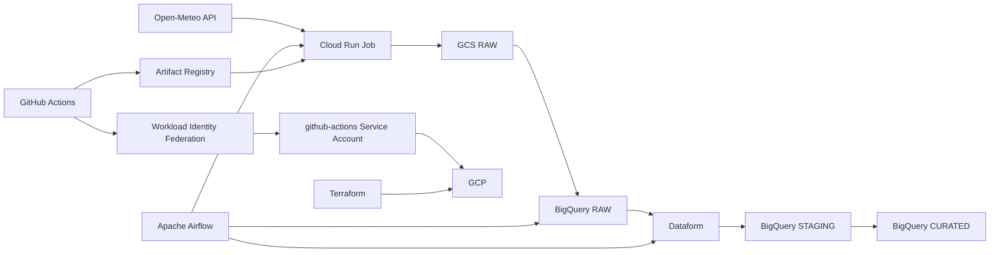

# GCP Weather Data Platform

A production-oriented data engineering project built on Google Cloud Platform.

The platform ingests weather data from the Open-Meteo API, stores raw data in Google Cloud Storage and BigQuery, transforms it with Dataform, and orchestrates the pipeline with Apache Airflow.

The project is progressively extended with additional ingestion patterns, Infrastructure as Code, security practices and CI/CD workflows.

## Architecture



## Tech Stack

- Google Cloud Platform
- BigQuery
- Google Cloud Storage
- Cloud Run Jobs
- Artifact Registry
- Dataform
- Apache Airflow
- Terraform
- GitHub Actions
- Workload Identity Federation
- Python
- Docker
- Ruff

## Repository Structure

```text
.
├── infrastructure/
│   └── terraform/
│       └── environments/
│           └── dev/
│               ├── backend.tf
│               ├── versions.tf
│               ├── providers.tf
│               ├── variables.tf
│               ├── main.tf
│               ├── service_accounts.tf
│               ├── iam.tf
│               ├── cloud_run.tf
│               ├── dataform.tf
│               ├── artifact_registry.tf
│               ├── github_actions.tf
│               ├── outputs.tf
│               └── terraform.tfvars.example
│
├── ingestion/
│   └── open-meteo/
│       ├── main.py
│       ├── requirements.txt
│       ├── Dockerfile
│       └── .dockerignore
│
├── orchestration/
│   └── airflow/
│       ├── dags/
│       │   └── weather_ingestion_pipeline.py
│       └── docker-compose.yaml
│
├── transformation/
│   └── dataform/
│       ├── workflow_settings.yaml
│       └── definitions/
│
├── docs/
│
├── .github/
│   └── workflows/
│       ├── ci.yml
│       └── build-open-meteo.yml
│
├── pyproject.toml
├── .gitignore
└── README.md
```

## Current Pipeline

The Open-Meteo ingestion pipeline follows:

```text
Open-Meteo API
    ↓
Cloud Run Job
    ↓
Google Cloud Storage - RAW
    ↓
BigQuery - RAW
    ↓
Dataform
    ↓
BigQuery - STAGING
    ↓
BigQuery - CURATED
```

Apache Airflow orchestrates the pipeline and uses its logical data interval to make ingestion and transformations deterministic and replayable.

For each scheduled run, Airflow:

1. Executes the Open-Meteo Cloud Run Job.
2. Waits for the expected GCS object to be refreshed.
3. Loads the raw NDJSON file into BigQuery.
4. Compiles Dataform with the target processing date.
5. Executes the Dataform workflow.
6. Produces a deduplicated incremental staging dataset.

## Data Layers

The project follows a layered data architecture.

### RAW

Raw data is kept close to the source and can contain multiple ingestion versions for the same logical record.

The goal of the RAW layer is to preserve source data and make ingestion replayable.

### STAGING

Data is cleaned, typed and deduplicated.

For the Open-Meteo pipeline, the logical grain is:

```text
(date, location_name)
```

Dataform incremental models use a `uniqueKey` and `MERGE` strategy to keep the latest ingestion for each logical record.

The latest record is determined using ingestion metadata such as:

```text
_ingested_at
_run_id
```

### CURATED

The curated layer contains data prepared for downstream analytics and business use cases.

It is separated from STAGING so that technical transformations and business-facing models can evolve independently.

## Open-Meteo Ingestion

The Open-Meteo ingestion component is implemented in Python and executed as a Cloud Run Job.

It:

- calls the Open-Meteo API
- supports a target processing date
- retries transient HTTP failures
- generates NDJSON
- writes raw data to GCS
- emits structured logs
- runs using a dedicated Service Account

The ingestion code lives in:

```text
ingestion/open-meteo/
```

The application is packaged as a Docker image:

```text
Python application
    ↓
Docker image
    ↓
Artifact Registry
    ↓
Cloud Run Job
```

Docker images are versioned using Git commit SHAs to provide traceability between source code and deployed workloads.

Example:

```text
open-meteo:a84dc312f68e
```

instead of relying on mutable tags such as:

```text
latest
```

## Airflow Orchestration

Apache Airflow is currently run locally using Docker Compose.

The DAG is versioned in Git:

```text
orchestration/airflow/dags/weather_ingestion_pipeline.py
```

Airflow coordinates the execution of external services rather than performing data processing itself.

The DAG currently orchestrates:

```text
Cloud Run ingestion
    ↓
GCS object availability
    ↓
BigQuery RAW load
    ↓
Dataform compilation
    ↓
Dataform workflow execution
```

A freshness-aware GCS sensor ensures that Airflow waits for the object produced by the current pipeline run rather than accepting an older file already present in the bucket.

A future production deployment can use Google Cloud Composer.

## Dataform

Dataform manages SQL transformations between BigQuery data layers.

The Dataform project contains:

```text
transformation/dataform/
├── workflow_settings.yaml
└── definitions/
```

Transformations are versioned as code and executed programmatically by Airflow using the Dataform API.

The STAGING model uses:

- incremental processing
- `uniqueKey`
- BigQuery `MERGE`
- partitioning
- clustering
- assertions
- source deduplication
- processing-date variables

This makes transformations deterministic and safe to replay.

## Infrastructure as Code

Terraform manages the GCP infrastructure.

Currently managed resources include:

- BigQuery datasets
- Service Accounts
- IAM permissions
- Cloud Run Jobs
- Artifact Registry
- Dataform repository
- GitHub Workload Identity Federation

Existing resources originally created manually are progressively imported into Terraform before Terraform becomes their source of truth.

This allows the project to move from:

```text
ClickOps
    ↓
Understand the resource
    ↓
Import into Terraform
    ↓
Terraform becomes source of truth
```

The Terraform state is stored remotely in Google Cloud Storage.

```text
Git
→ Terraform configuration

GCS
→ Terraform state

GCP
→ Real infrastructure
```

Infrastructure changes follow:

```text
terraform fmt
    ↓
terraform validate
    ↓
terraform plan
    ↓
review
    ↓
terraform apply
```

Environment-specific configuration is separated from reusable Terraform code.

```text
variables.tf
→ declares expected configuration

terraform.tfvars.example
→ documents example values

terraform.tfvars
→ local environment configuration
→ not committed
```

Deployment-time values are not stored as permanent repository configuration.

For example, the Open-Meteo Docker image version is provided through:

```text
TF_VAR_open_meteo_image_tag
```

When a deployment is applied, Terraform stores the deployed value in its remote state.

The currently deployed image version can therefore be retrieved with:

```bash
terraform output -raw open_meteo_image_tag
```

## Application Versioning

Application versions and environment configuration have separate responsibilities.

```text
GitHub repository variables
│
├── GCP_PROJECT_ID
├── GCP_REGION
├── GCP_WIF_PROVIDER
└── GCP_SERVICE_ACCOUNT
        ↓
Stable environment configuration
```

The candidate application version is derived directly from Git:

```text
Git commit
    ↓
github.sha
    ↓
Docker image tag
```

The version currently managed by Terraform is persisted in the remote Terraform state:

```text
Terraform state
    ↓
open_meteo_image_tag
    ↓
currently deployed image
```

This avoids maintaining a mutable application version manually in GitHub repository variables.

## Security

The project follows least-privilege IAM principles.

Key practices include:

- dedicated Service Accounts per workload
- project-level permissions only when required
- resource-level IAM when possible
- dataset-level BigQuery permissions
- Service Account impersonation
- Secret Manager for sensitive values
- Application Default Credentials for local development
- GitHub OIDC authentication
- Workload Identity Federation
- no long-lived Service Account JSON keys in GitHub
- separate runtime and CI/CD identities

For example, the Dataform runtime identity has:

```text
Project
└── BigQuery Job User

weather_raw
└── BigQuery Data Viewer

weather_staging
└── BigQuery Data Editor

dataform_assertions
└── BigQuery Data Editor
```

The Dataform Service Agent is allowed to impersonate the dedicated `dataform-runner` Service Account.

The Cloud Run ingestion workload uses its own identity:

```text
open-meteo-ingestion
```

GitHub Actions uses another dedicated identity:

```text
github-actions
```

This prevents CI/CD, ingestion and transformation workloads from sharing the same credentials or permissions.

Artifact Registry write access for GitHub Actions is scoped to the dedicated Docker repository rather than granted across the entire project.

## GitHub Authentication

GitHub Actions authenticates to Google Cloud using Workload Identity Federation.

```text
GitHub Actions
    ↓
GitHub OIDC token
    ↓
GCP Workload Identity Provider
    ↓
github-actions Service Account
    ↓
temporary GCP credentials
```

The Workload Identity Provider restricts authentication to the expected GitHub repository.

This avoids storing credentials such as:

```text
service-account-key.json
```

inside GitHub Secrets.

Authentication and authorization remain separate:

```text
Workload Identity Federation
→ Who is calling?

IAM
→ What is that identity allowed to do?
```

## CI/CD

GitHub Actions is used to automate project validation and progressively automate application deployment.

### Continuous Integration

The main CI workflow runs on pushes to the main development branch and on pull requests.

Python code is validated with:

```text
ruff check .
ruff format --check .
```

Terraform is validated with:

```text
terraform fmt -check -recursive
terraform init
terraform validate
terraform plan
```

The CI workflow authenticates to GCP using Workload Identity Federation and reads the real remote Terraform state.

Before running `terraform plan`, CI retrieves the Open-Meteo image tag currently stored in Terraform state:

```text
terraform init
    ↓
terraform output open_meteo_image_tag
    ↓
TF_VAR_open_meteo_image_tag
    ↓
terraform plan
```

This is important because a commit unrelated to Open-Meteo must not be interpreted as a new application release.

For example:

```text
README change
    ↓
new Git SHA
    ↓
CI runs
    ↓
current deployed Open-Meteo tag loaded from Terraform state
    ↓
no fake Open-Meteo release
```

### Open-Meteo Build

The Open-Meteo build workflow is scoped to:

```text
ingestion/open-meteo/**
```

This means unrelated repository changes do not create unnecessary Docker images.

```text
README change
→ no Open-Meteo build

Terraform change
→ no Open-Meteo build

Airflow change
→ no Open-Meteo build

Open-Meteo change
→ Docker build
```

When triggered, the workflow will use the Git commit SHA as an immutable Docker image tag:

```text
Open-Meteo source change
    ↓
Git commit
    ↓
github.sha
    ↓
Docker build
    ↓
open-meteo:<github.sha>
    ↓
Artifact Registry
```

The build workflow can also be started manually using GitHub Actions `workflow_dispatch`.

### Deployment Model

Build and deployment are intentionally treated as separate operations.

```text
BUILD
Docker image creation
        ↓
Artifact Registry

DEPLOY
Selected image
        ↓
Cloud Run Job
```

The target deployment flow is:

```text
Open-Meteo change
    ↓
GitHub SHA
    ↓
Docker build
    ↓
Artifact Registry push
    ↓
TF_VAR_open_meteo_image_tag=<github.sha>
    ↓
Terraform apply
    ↓
Cloud Run Job updated
    ↓
Terraform state updated
```

No GitHub variable needs to be manually updated with the latest application version.

## Idempotency

The pipeline is designed to be safely replayable.

A rerun for the same logical date can create another RAW ingestion version, while the STAGING layer keeps only the latest logical record.

```text
RAW

2026-10-10 / Paris / run A
2026-10-10 / Paris / run B

        ↓ Dataform

STAGING

2026-10-10 / Paris / run B
```

This allows historical runs and failed pipelines to be replayed without producing duplicated business records downstream.

Idempotency is handled at multiple levels:

```text
Ingestion
→ deterministic target date and object path

RAW
→ ingestion history can be preserved

STAGING
→ deduplication + MERGE on logical grain

Orchestration
→ deterministic Airflow data interval
```

## Planned Ingestion Patterns

The platform demonstrates several ingestion strategies depending on the source system.

### REST API

```text
Open-Meteo
→ Python
→ Cloud Run Job
→ GCS
→ BigQuery
```

This demonstrates custom API ingestion when managed connectors are not appropriate.

### AWS S3

```text
AWS S3
→ BigQuery Data Transfer Service
→ BigQuery
```

This demonstrates managed multi-cloud batch ingestion.

### PostgreSQL

```text
PostgreSQL
→ Datastream
→ BigQuery
```

This demonstrates Change Data Capture for transactional databases.

The objective is not to force every source through the same ingestion mechanism, but to choose the appropriate service based on the source and ingestion requirements.

## Development

Python formatting and linting are managed globally with Ruff through:

```text
pyproject.toml
```

Runtime dependencies remain specific to each workload.

The Open-Meteo ingestion dependencies are defined in:

```text
ingestion/open-meteo/requirements.txt
```

The local Airflow environment is configured through Docker Compose.

### Python checks

```bash
ruff check .
ruff format --check .
```

### Terraform checks

From:

```text
infrastructure/terraform/environments/dev/
```

run:

```bash
terraform fmt
terraform validate
terraform plan
```

For local Terraform operations, deployment-time values can optionally be loaded from a non-committed `.env` file.

Example:

```bash
TF_VAR_open_meteo_image_tag="your-image-tag"
```

With Git Bash:

```bash
set -a
source .env
set +a
```

Local `.env` and `terraform.tfvars` files are not committed.

Example files can be versioned to document the expected configuration:

```text
.env.example
terraform.tfvars.example
```

## Design Principles

The project intentionally applies several production-oriented principles:

```text
Infrastructure
→ Infrastructure as Code

Identity
→ one Service Account per responsibility

Permissions
→ least privilege and narrow resource scopes

Authentication
→ short-lived credentials

Application releases
→ immutable Git SHA image tags

Configuration
→ stable configuration separated from release state

Data
→ RAW / STAGING / CURATED separation

Processing
→ incremental and idempotent

Orchestration
→ Airflow coordinates services

Transformations
→ SQL transformations managed by Dataform

Terraform
→ remote state in GCS

CI
→ automated validation and infrastructure planning

CD
→ build and deployment separated
```

## Roadmap

- [x] Open-Meteo API ingestion
- [x] Cloud Run Job
- [x] GCS RAW storage
- [x] BigQuery RAW ingestion
- [x] Airflow orchestration
- [x] Dataform incremental transformations
- [x] Service Account separation
- [x] Least-privilege IAM
- [x] Terraform foundation
- [x] Remote Terraform state in GCS
- [x] Import existing GCP resources into Terraform
- [x] Cloud Run Job managed by Terraform
- [x] Artifact Registry managed by Terraform
- [x] Dataform repository managed by Terraform
- [x] Dockerized Open-Meteo ingestion
- [x] GitHub Actions CI
- [x] Workload Identity Federation
- [x] Terraform plan using remote state from GitHub Actions
- [ ] Validate automated Docker build and Artifact Registry push
- [ ] Automated Cloud Run deployment
- [ ] Dataform Git integration
- [ ] AWS S3 ingestion integration
- [ ] PostgreSQL CDC with Datastream integration
- [ ] Monitoring and data quality
- [ ] Production-ready Airflow / Cloud Composer deployment
