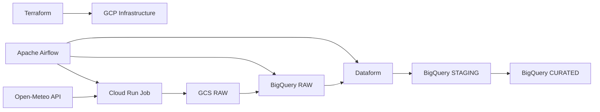

# GCP Weather Data Platform

A production-oriented data engineering project built on Google Cloud Platform.

The platform ingests weather data from the Open-Meteo API, stores raw data in Google Cloud Storage and BigQuery, transforms it with Dataform, and orchestrates the pipeline with Apache Airflow.

The project is progressively extended with additional ingestion patterns, including AWS S3 batch ingestion and PostgreSQL CDC.

## Architecture



## Tech Stack

- Google Cloud Platform
- BigQuery
- Google Cloud Storage
- Cloud Run Jobs
- Dataform
- Apache Airflow
- Terraform
- Python
- Docker

## Repository Structure

```text
.
├── infrastructure/
│   └── terraform/
│       └── environments/
│           └── dev/
│
├── ingestion/
│   └── open-meteo/
│       ├── main.py
│       ├── requirements.txt
│       └── Procfile
│
├── orchestration/
│   └── airflow/
│       ├── dags/
│       │   └── weather_ingestion_pipeline.py
│       └── docker-compose.yaml
│
├── transformation/
│   └── dataform/
│       ├── workflow_settings.yaml
│       └── definitions/
│
├── docs/
├── .github/
│   └── workflows/
│
├── pyproject.toml
├── .gitignore
└── README.md
```

## Current Pipeline

The Open-Meteo ingestion pipeline follows:

```text
Open-Meteo API
    ↓
Cloud Run Job
    ↓
Google Cloud Storage - RAW
    ↓
BigQuery - RAW
    ↓
Dataform
    ↓
BigQuery - STAGING
    ↓
BigQuery - CURATED
```

Apache Airflow orchestrates the pipeline and uses its logical data interval to make ingestion and transformations deterministic and replayable.

For each scheduled run, Airflow:

1. Executes the Open-Meteo Cloud Run Job.
2. Waits for the expected GCS object to be refreshed.
3. Loads the raw NDJSON file into BigQuery.
4. Compiles Dataform with the target processing date.
5. Executes the Dataform workflow.
6. Produces a deduplicated incremental staging dataset.

## Data Layers

The project follows a layered data architecture:

### RAW

Raw data is kept close to the source and can contain multiple ingestion versions for the same logical record.

### STAGING

Data is cleaned, typed and deduplicated.

For the Open-Meteo pipeline, the logical grain is:

```text
(date, location_name)
```

Dataform incremental models use a `uniqueKey` and `MERGE` strategy to keep the latest ingestion for each logical record.

### CURATED

The curated layer contains data prepared for downstream analytics and business use cases.

## Infrastructure as Code

Terraform manages the GCP infrastructure.

Currently managed resources include:

- BigQuery datasets
- Service Accounts
- IAM permissions
- Remote Terraform state in Google Cloud Storage

Existing resources originally created manually are progressively imported into Terraform before Terraform becomes their source of truth.

The Terraform state is stored remotely in GCS.

```text
Git
→ Terraform configuration

GCS
→ Terraform state

GCP
→ Real infrastructure
```

Infrastructure changes follow:

```text
terraform fmt
    ↓
terraform validate
    ↓
terraform plan
    ↓
review
    ↓
terraform apply
```

## Security

The project follows least-privilege IAM principles.

Examples include:

- dedicated Service Accounts per workload
- project-level permissions only when required
- dataset-level BigQuery permissions
- Service Account impersonation
- Secret Manager for sensitive values
- Application Default Credentials
- no long-lived Service Account JSON keys

For example, the Dataform runtime identity has:

```text
Project
└── BigQuery Job User

weather_raw
└── BigQuery Data Viewer

weather_staging
└── BigQuery Data Editor

dataform_assertions
└── BigQuery Data Editor
```

The Dataform Service Agent is allowed to impersonate the dedicated `dataform-runner` Service Account.

## Idempotency

The pipeline is designed to be safely replayable.

A rerun for the same logical date can create another RAW ingestion version, while the STAGING layer keeps only the latest logical record.

```text
RAW
2026-10-10 / Paris / run A
2026-10-10 / Paris / run B

        ↓ Dataform

STAGING
2026-10-10 / Paris / run B
```

This allows historical runs and failed pipelines to be replayed without producing duplicated business records downstream.

## Open-Meteo Ingestion

The Open-Meteo ingestion component is implemented in Python and executed as a Cloud Run Job.

It:

- calls the Open-Meteo API
- supports a target processing date
- retries transient HTTP failures
- generates NDJSON
- writes raw data to GCS
- emits structured logs
- runs using a dedicated Service Account

The ingestion code lives in:

```text
ingestion/open-meteo/
```

## Airflow Orchestration

Apache Airflow is currently run locally using Docker Compose.

The DAG is versioned in Git:

```text
orchestration/airflow/dags/weather_ingestion_pipeline.py
```

Airflow is responsible for orchestration only. Data processing remains inside the dedicated GCP services.

A future production deployment can use Google Cloud Composer.

## Dataform

Dataform manages SQL transformations between BigQuery data layers.

The Dataform project contains:

```text
transformation/dataform/
├── workflow_settings.yaml
└── definitions/
```

Transformations are versioned as code and executed programmatically by Airflow using the Dataform API.

## Planned Ingestion Patterns

The platform will demonstrate several ingestion strategies depending on the source system.

### REST API

```text
Open-Meteo
→ Python
→ Cloud Run Job
→ GCS
→ BigQuery
```

### AWS S3

```text
AWS S3
→ BigQuery Data Transfer Service
→ BigQuery
```

This demonstrates managed multi-cloud batch ingestion.

### PostgreSQL

```text
PostgreSQL
→ Datastream
→ BigQuery
```

This demonstrates Change Data Capture for transactional databases.

## Development

Python formatting and linting are managed globally with Ruff through:

```text
pyproject.toml
```

Runtime dependencies remain specific to each workload.

The Open-Meteo ingestion dependencies are defined in:

```text
ingestion/open-meteo/requirements.txt
```

The local Airflow environment is currently configured through Docker Compose.

## Roadmap

- [x] Open-Meteo API ingestion
- [x] Cloud Run Job
- [x] GCS RAW storage
- [x] BigQuery RAW ingestion
- [x] Airflow orchestration
- [x] Dataform incremental transformations
- [x] Service Account separation
- [x] Least-privilege IAM
- [x] Terraform foundation
- [x] Remote Terraform state in GCS
- [x] Import existing GCP resources into Terraform
- [ ] Cloud Run Job managed by Terraform
- [ ] Artifact Registry managed by Terraform
- [ ] Dataform resources managed by Terraform
- [ ] CI/CD
- [ ] AWS S3 ingestion
- [ ] PostgreSQL CDC with Datastream
- [ ] Monitoring and data quality
- [ ] Production-ready Airflow / Cloud Composer deployment
