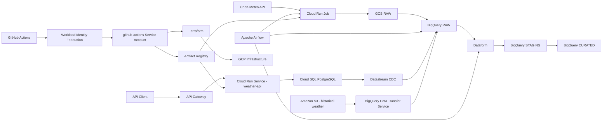

# GCP Weather Data Platform

A production-oriented data engineering project built on Google Cloud Platform.

The platform currently combines multiple complementary workloads:

- a batch weather data pipeline based on Open-Meteo, Cloud Run Jobs, GCS, BigQuery, Dataform and Airflow
- an operational Weather API exposed through API Gateway, backed by a private Cloud Run service and Cloud SQL for PostgreSQL
- PostgreSQL Change Data Capture with Datastream into BigQuery RAW
- historical multi-cloud ingestion from Amazon S3 into BigQuery through BigQuery Data Transfer Service

The project is progressively extended with additional ingestion patterns, Infrastructure as Code, security controls and CI/CD workflows.

## Architecture



The current architecture deliberately separates:

```text
Analytical data pipeline
Open-Meteo → GCS → BigQuery → Dataform

Operational API path
Client → API Gateway → Cloud Run → PostgreSQL

CDC ingestion path
PostgreSQL → Datastream → BigQuery RAW

Historical batch ingestion path
Amazon S3 → BigQuery Data Transfer Service → BigQuery RAW

Delivery platform
GitHub Actions → WIF → Artifact Registry → Terraform → GCP
```

## Tech Stack

- Google Cloud Platform
- BigQuery
- Google Cloud Storage
- Cloud Run Jobs
- Cloud Run Services
- Cloud SQL for PostgreSQL
- Datastream
- BigQuery Data Transfer Service
- Amazon S3
- Parquet
- API Gateway
- Secret Manager
- Artifact Registry
- Dataform
- Apache Airflow
- Terraform
- GitHub Actions
- Workload Identity Federation
- Python
- FastAPI
- SQLAlchemy
- Cloud SQL Python Connector
- Docker
- Ruff

## Repository Structure

```text
.
├── infrastructure/
│   └── terraform/
│       └── environments/
│           └── dev/
│               ├── backend.tf
│               ├── versions.tf
│               ├── providers.tf
│               ├── variables.tf
│               ├── data_sources.tf
│               ├── bigquery_datasets.tf
│               ├── service_accounts.tf
│               ├── iam_workloads.tf
│               ├── iam_github_actions.tf
│               ├── iam_service_agents.tf
│               ├── iam_cloud_run.tf
│               ├── moved.tf
│               ├── services.tf
│               ├── cloud_run.tf
│               ├── dataform.tf
│               ├── developer_connect.tf
│               ├── artifact_registry.tf
│               ├── github_actions.tf
│               ├── secret_manager.tf
│               ├── api_gateway.tf
│               ├── datastream.tf
│               ├── bigquery_tables.tf
│               ├── bigquery_transfer.tf
│               ├── bigquery_policy_tags.tf
│               ├── outputs.tf
│               ├── terraform.tfvars.example
│               └── .terraform.lock.hcl
│
│       └── schemas/
│           └── s3_historical_weather.json
│
├── ingestion/
│   └── open-meteo/
│       ├── main.py
│       ├── requirements.txt
│       ├── Dockerfile
│       └── .dockerignore
│
├── api/
│   └── weather-api/
│       ├── main.py
│       ├── requirements.txt
│       ├── Dockerfile
│       ├── .dockerignore
│       └── openapi.yaml
│
├── database/
│   └── postgres/
│       ├── schema.sql
│       ├── seed.sql
│       ├── roles.sql
│       ├── datastream-publication.sql
│       └── datastream-slot.sql
│
├── orchestration/
│   └── airflow/
│       ├── dags/
│       │   └── weather_ingestion_pipeline.py
│       └── docker-compose.yaml
│
├── transformation/
│   └── dataform/
│       ├── workflow_settings.yaml
│       └── definitions/
│           ├── sources/
│           │   └── raw_sources.js
│           ├── staging/
│           │   ├── stg_open_meteo.sqlx
│           │   ├── stg_postgres_weather_observations.sqlx
│           │   ├── stg_postgres_weather_stations.sqlx
│           │   ├── stg_s3_historical_weather.sqlx
│           │   └── assertions/
│           │       └── assert_stg_postgres_observations_grain.sqlx
│           └── curated/
│               ├── dimensions/
│               │   ├── dim_weather_location.sqlx
│               │   └── dim_weather_station_contact.sqlx
│               ├── bridges/
│               │   └── bridge_weather_source_location.sqlx
│               └── facts/
│                   ├── fct_weather_observation.sqlx
│                   └── fct_weather_daily_open_meteo.sqlx
│
├── scripts/
│   ├── generate_historical_weather.py
│   └── requirements.txt
│
├── docs/
│
├── .github/
│   └── workflows/
│       ├── ci.yml
│       ├── build-open-meteo.yml
│       └── deploy-weather-api.yml
│
├── pyproject.toml
├── .gitignore
└── README.md
```

Terraform uses `for_each` maps for repeated resources with the same type and configuration shape. The `moved.tf` file records resource-address migrations so Terraform can update the remote state without recreating those resources; the state itself remains in the GCS backend.

## Current Data Pipeline

The Open-Meteo ingestion pipeline follows:

```text
Open-Meteo API
    ↓
Cloud Run Job
    ↓
Google Cloud Storage - RAW
    ↓
BigQuery - RAW
    ↓
Dataform
    ↓
BigQuery - STAGING
    ↓
BigQuery - CURATED
```

Apache Airflow orchestrates the pipeline and uses its logical data interval to make ingestion and transformations deterministic and replayable.

For each scheduled run, Airflow:

1. Executes the Open-Meteo Cloud Run Job.
2. Waits for the expected GCS object to be refreshed.
3. Loads the raw NDJSON file into BigQuery.
4. Compiles Dataform with the target processing date.
5. Executes the Dataform workflow.
6. Produces a deduplicated incremental staging dataset.

## Operational Weather API

The platform also exposes weather station data through a dedicated API path:

```text
Client
    ↓ API key
API Gateway
    ↓ authenticated backend call
Cloud Run Service - weather-api
    ↓ Cloud SQL Python Connector
Cloud SQL PostgreSQL
```

The Cloud Run backend remains private. API Gateway is the intended public entry point and invokes Cloud Run using the dedicated:

```text
weather-api-gateway
```

Service Account.

The application runtime uses a separate:

```text
weather-api
```

Service Account.

The FastAPI service currently exposes:

```text
GET /health
GET /stations
GET /stations/{station_id}
GET /stations/{station_id}/observations
```

The health endpoint checks both application availability and database connectivity.

API Gateway is configured from:

```text
api/weather-api/openapi.yaml
```

The API definition is versioned in Git and managed through Terraform.

## PostgreSQL Operational Source

Cloud SQL for PostgreSQL represents an operational weather station system.

The current model contains:

```text
weather_stations
weather_observations
```

`weather_stations` stores station metadata such as:

- station identifier
- station name
- city
- country
- region
- latitude and longitude
- operator contact
- active status

`weather_observations` stores time-series observations such as:

- station identifier
- observation timestamp
- temperature
- humidity
- precipitation
- wind speed

The model intentionally remains normalized because PostgreSQL represents the OLTP side of the platform.

BigQuery will later expose analytics-oriented models in the CURATED layer.

PostgreSQL setup is versioned in:

```text
database/postgres/
```

This includes:

```text
schema.sql
seed.sql
roles.sql
datastream-publication.sql
datastream-slot.sql
```

The PostgreSQL source is connected to BigQuery through Datastream CDC.

The source-side replication objects are:

```text
Publication
→ weather_datastream_publication

Replication slot
→ weather_datastream_slot
```

Datastream replicates only:

```text
public.weather_stations
public.weather_observations
```

into:

```text
weather_raw.public_weather_stations
weather_raw.public_weather_observations
```

The stream uses BigQuery `Merge` mode with a maximum freshness of 15 minutes. Initial backfill and live CDC have both been validated with `INSERT`, `UPDATE` and `DELETE` operations.

For cost control in the development environment, Cloud SQL can remain stopped and the Datastream stream paused between test sessions. Terraform manages the stream configuration, while the operational `RUNNING` / `PAUSED` state is intentionally controlled outside Terraform.

## PostgreSQL CDC with Datastream

The operational PostgreSQL source is replicated into BigQuery RAW using Google Cloud Datastream.

```text
Cloud SQL PostgreSQL
    ↓ logical decoding / WAL
Datastream
    ↓ CDC
BigQuery RAW
```

The source connection profile uses the `postgres` database and the dedicated `datastream` PostgreSQL role. Connectivity uses Datastream static public IP allowlisting against the Cloud SQL public endpoint.

The PostgreSQL password is stored in Secret Manager as:

```text
datastream-db-password
```

Datastream references the secret through Secret Manager rather than storing the credential in Git or Terraform.

The stream:

```text
weather-postgres-to-bigquery
```

replicates:

```text
public.weather_stations
public.weather_observations
```

into the `weather_raw` BigQuery dataset.

The destination configuration uses:

```text
Mode
→ Merge

Data freshness
→ 900s

Backfill
→ enabled
```

The CDC behavior has been validated end-to-end:

```text
INSERT PostgreSQL
→ row appears in BigQuery

UPDATE PostgreSQL
→ row is updated in BigQuery

DELETE PostgreSQL
→ row is removed from BigQuery
```

The Datastream connection profiles, stream configuration, Secret Manager metadata and related IAM are managed with Terraform.

For the development environment, the Datastream stream is normally kept paused and Cloud SQL stopped between test sessions to control cost.

## AWS S3 Historical Weather Ingestion

Historical weather data is generated as Parquet files and stored in Amazon S3 to represent an external upstream partner system.

```text
Historical weather generator
    ↓
Parquet
    ↓
Amazon S3
    ↓
BigQuery Data Transfer Service
    ↓
weather_raw.s3_historical_weather
```

The S3 layout follows a date-oriented hierarchy:

```text
historical/
└── year=2026/
    ├── month=08/
    │   └── weather_2026_08.parquet
    ├── month=09/
    │   └── weather_2026_09.parquet
    └── month=10/
        └── weather_2026_10.parquet
```

The generated historical dataset uses the grain:

```text
one row
=
one station
+
one observation timestamp
```

The destination table is:

```text
de-gcp-lab.weather_raw.s3_historical_weather
```

and is partitioned by `DATE(observed_at)` and clustered by `station_id`.

The BigQuery Data Transfer configuration uses:

```text
Source
→ Amazon S3

File format
→ Parquet

Write disposition
→ WRITE_APPEND

Schedule
→ on demand
```

The transfer was validated incrementally:

```text
Initial run
→ August + September 2026
→ 183 rows
→ 3 stations

Second run
→ October 2026 added to S3
→ +93 rows

Final result
→ 276 rows
→ 3 stations
```

The second run loaded the newly added S3 object without duplicating the already transferred historical files.

The S3 bucket and AWS IAM identity intentionally remain outside the GCP Terraform boundary because they represent an external upstream system. The GCP-side destination table, transfer configuration, Service Account, IAM and Secret Manager integration are managed with Terraform.

### S3 Transfer Credentials

The transfer uses two separate identities:

```text
GCP identity
→ bigquery-s3-transfer Service Account

AWS identity
→ AWS access key ID + secret access key
```

The AWS secret access key is stored in Google Secret Manager as:

```text
aws-s3-secret-access-key
```

Terraform retrieves this value through an ephemeral Secret Manager resource and passes it to the BigQuery Data Transfer resource through the provider's write-only `secret_access_key_wo` argument.

```text
Secret Manager
    ↓ ephemeral read
Terraform
    ↓ write-only argument
BigQuery Data Transfer Service
```

This keeps the AWS secret access key out of:

```text
Git
terraform.tfvars
Terraform state
Terraform plan output
```

The AWS access key ID remains a normal Terraform input because it is an identifier rather than the secret credential.

## Data Layers

The project follows a layered data architecture.

### RAW

Raw data is kept close to the source and can contain multiple ingestion versions for the same logical record.

The goal of the RAW layer is to preserve source data and make ingestion replayable.

### STAGING

Data is cleaned, typed and deduplicated.

For the Open-Meteo pipeline, the logical grain is:

```text
(date, location_name)
```

Dataform incremental models use a `uniqueKey` and `MERGE` strategy to keep the latest ingestion for each logical record.

The latest record is determined using ingestion metadata such as:

```text
_ingested_at
_run_id
```

The multi-source STAGING layer keeps each source-specific model separate:

- `stg_open_meteo`: daily weather by `(date, location_name)`, incrementally merged.
- `stg_postgres_weather_stations`: the current PostgreSQL station dimension, keyed by `station_id`.
- `stg_postgres_weather_observations`: current PostgreSQL observations, retaining `observation_id` and checking the business grain `(station_id, observed_at)`.
- `stg_s3_historical_weather`: historical S3 observations at `(station_id, observed_at)`.

The PostgreSQL models are rebuilt from the current Datastream BigQuery tables so source-side deletes are reflected in STAGING. Datastream metadata is retained as lineage. `operator_email` is excluded from the general-purpose analytical models; it is retained in a dedicated CURATED contact dimension protected with BigQuery Column-Level Security. The source models remain separate in STAGING; CURATED standardizes compatible point-observation fields while keeping daily Open-Meteo metrics at their native daily grain.

### CURATED

The curated layer contains data prepared for downstream analytics and business use cases. It currently combines the three sources through a canonical city dimension and a source-location bridge:

- `dim_weather_location`: one row per canonical city, with six locations across France, the United States, Japan and Singapore.
- `dim_weather_station_contact`: one row per PostgreSQL weather station, including synthetic operator contact details. Access is restricted with a BigQuery policy tag and France-only row access policy.
- `bridge_weather_source_location`: maps each source identifier to a canonical `location_id`; the current mapping contains 6 PostgreSQL, 3 S3 and 1 Open-Meteo key.
- `fct_weather_observation`: PostgreSQL and S3 observations at source-record/timestamp grain. PostgreSQL `observation_id` is retained; S3 uses a source record key built from station and timestamp.
- `fct_weather_daily_open_meteo`: Open-Meteo daily metrics at `(location_id, observation_date)` grain.

Both fact models use the same canonical `location_id`, but remain separate so daily API aggregates are not mixed with timestamped station observations. Dataform assertions validate keys and required mapping fields.

## Open-Meteo Ingestion

The Open-Meteo ingestion component is implemented in Python and executed as a Cloud Run Job.

It:

- calls the Open-Meteo API
- supports a target processing date
- retries transient HTTP failures
- generates NDJSON
- writes raw data to GCS
- emits structured logs
- runs using a dedicated Service Account

The ingestion code lives in:

```text
ingestion/open-meteo/
```

The application is packaged as a Docker image:

```text
Python application
    ↓
Docker image
    ↓
Artifact Registry
    ↓
Cloud Run Job
```

Docker images are versioned using Git commit SHAs to provide traceability between source code and application artifacts.

Example:

```text
open-meteo:a84dc312f68e...
```

instead of relying on mutable tags such as:

```text
latest
```

## Airflow Orchestration

Apache Airflow is currently run locally using Docker Compose.

The DAG is versioned in Git:

```text
orchestration/airflow/dags/weather_ingestion_pipeline.py
```

Airflow coordinates the execution of external services rather than performing data processing itself.

The DAG currently orchestrates:

```text
Cloud Run ingestion
    ↓
GCS object availability
    ↓
BigQuery RAW load
    ↓
Dataform compilation
    ↓
Dataform workflow execution
```

A freshness-aware GCS sensor ensures that Airflow waits for an object updated during the current DAG run rather than accepting a stale object already present in the bucket.

The repository also contains an optional Cloud Composer lab in the separate Terraform root `infrastructure/terraform/environments/composer-lab/`. This is a small, temporary Composer environment in the same GCP project; it is not created by the normal application deployment workflows.

To create it, copy `terraform.tfvars.example` to `terraform.tfvars`, set `project_id` and `github_repository` (`owner/repository`), then run Terraform from that directory:

```powershell
Set-Location infrastructure/terraform/environments/composer-lab
terraform init
terraform plan
terraform apply
```

After Terraform reports that the environment is ready, publish the DAG from GitHub Actions:

1. Open **Actions → Deploy Airflow DAGs → Run workflow** on the `master` branch.
2. The workflow authenticates with the existing GitHub Workload Identity Federation configuration, discovers the Composer DAG bucket, and uploads the Python files from `orchestration/airflow/dags/`.
3. Open the Airflow UI and confirm that `weather_ingestion_pipeline` appears before triggering a run.

The workflow is manual because a Terraform apply run locally does not notify GitHub. It also avoids failed uploads when the temporary Composer environment has been destroyed. It reuses the `dev` GitHub Actions variables `GCP_PROJECT_ID`, `GCP_REGION` and `GCP_WIF_PROVIDER`; `GCP_REGION` must match the Composer lab region. Terraform creates a dedicated `composer-dag-deployer` service account, allows only this GitHub repository to impersonate it through the existing Workload Identity Pool, and grants it `composer.environments.get` plus a custom GCS role on the Composer environment bucket. The GCS role can list object names and create/delete objects in that Composer-specific bucket, but cannot read object contents or change the Composer environment. The bucket-level grant is necessary because the generated Composer bucket is not separately managed by this Terraform root.

When the lab is no longer needed, run `terraform destroy` from the same Terraform root. The Terraform configuration and remote state remain available for the next `terraform apply`. Cloud Composer does not automatically delete its generated GCS bucket or retained Cloud Logging entries, so review those separately after destroying the environment.

This Composer lab demonstrates a managed Airflow deployment; it is not yet a claim that the platform is production-ready.

## Dataform

Dataform manages SQL transformations between BigQuery data layers.

The Dataform project contains:

```text
transformation/dataform/
├── workflow_settings.yaml
├── includes/               # shared JavaScript helpers for Dataform actions
└── definitions/
    ├── sources/             # RAW declarations
    ├── staging/             # source-specific STAGING models
    │   └── assertions/      # custom data assertions
    └── curated/
        ├── dimensions/
        ├── bridges/
        └── facts/
```

Transformations are versioned as code and executed programmatically by Airflow using the Dataform API.

### Git integration and repository synchronization

The Dataform project is maintained in this platform repository under `transformation/dataform/` as a Git subtree. The local Git remote named `dataform` points to the dedicated GitHub repository [Maugun/gcp-weather-dataform](https://github.com/Maugun/gcp-weather-dataform).

After committing Dataform changes in the platform repository, publish that subtree to the `master` branch of its dedicated repository with:

```bash
git subtree push --prefix=transformation/dataform dataform master
```

This sends the contents and history of `transformation/dataform/` to the Dataform repository without publishing the rest of the platform repository there. The subtree push is currently a manual step.

Terraform connects the GCP Dataform repository to GitHub through Developer Connect:

- Developer Connect connection: `github-dataform` in `europe-west9`.
- Git repository link: `Maugun-gcp-weather-dataform`.
- GCP Dataform repository: `weather-dataform`, in `europe-west9`, using `master` as its default branch.
- Dataform runtime service account: `dataform-runner`.

The Airflow DAG compiles and invokes the `weather-dataform` repository through the Dataform API, using the `dev` workspace. A manual compilation and workflow run against the Git-integrated repository has been completed successfully.

The Open-Meteo STAGING model uses:

- incremental processing
- `uniqueKey`
- BigQuery `MERGE`
- partitioning
- clustering
- assertions
- source deduplication
- processing-date variables

This makes transformations deterministic and safe to replay.

The multi-source PostgreSQL and S3 STAGING models are full table models over their current RAW state. They use Dataform assertions to enforce their source keys and required columns.

The multi-source STAGING and CURATED workflows were executed successfully in the `git-test` development workspace. STAGING contained 3 Open-Meteo rows, 12 PostgreSQL observations, 6 PostgreSQL stations and 276 S3 historical observations. CURATED validation returned 10 source-location mappings, 12 PostgreSQL and 276 S3 point observations with no unmapped locations, and 3 Open-Meteo daily rows for Paris across 3 dates.

### Data Quality Hardening

Dataform model-level assertions already enforce configured `uniqueKey` and `nonNull` rules, including the source keys and required mapping fields. The custom `assert_stg_postgres_observations_grain` assertion checks that a station does not have duplicate observations at the same timestamp. These checks run as part of the Dataform workflow and write assertion results to the `dataform_assertions` dataset.

Additional CURATED SQLX assertions return violating rows for two stable measurement-domain invariants:

- `assert_fct_weather_observation_measure_ranges`: humidity is between 0 and 100, and precipitation and wind speed are non-negative when present.
- `assert_fct_weather_daily_open_meteo_measure_ranges`: daily minimum temperature does not exceed the maximum, the mean stays within the daily range when all values are present, and precipitation, rain and wind speed are non-negative when present.

The bridge model's existing `nonNull` assertion on `location_id` already makes unmapped source locations a blocking failure; the diagnostic profile reports the same condition broken down by source. Weather measurements are nullable in the source schemas, so null counts are reported for investigation but are not blocking until the source data contract declares those fields mandatory.

Temperature min/max ranges are profiled rather than rejected using an arbitrary fixed threshold; unusual weather can be valid and should be investigated before adding a blocking rule. The manually runnable BigQuery profiles are versioned under `quality/diagnostics/`. They summarize point observations, daily Open-Meteo records and location mapping. Their counts are descriptive and are expected to change as the source data grows; missing keys, unmapped locations and invalid measurement counts should remain zero.

To run the automated checks, publish the Dataform subtree, pull it into the Git-integrated Dataform workspace and execute the workflow. Review the assertion actions for failures in the workflow details or in the `dataform_assertions` dataset. To inspect aggregate diagnostics, open and run the SQL files under `quality/diagnostics/` in BigQuery. The diagnostics help investigate data; the Dataform assertions enforce the stable rules in each workflow run.

The group-based Dataform workflow completed successfully with the new quality assertions. In the corresponding manual profiles, all missing-key, unmapped-location, invalid-range and negative-measurement counts were zero across 12 PostgreSQL observations, 276 S3 observations, 3 Open-Meteo daily rows and 10 source-location mappings. These counts record the validation run and are not fixed acceptance thresholds.

### Monitoring and Alerting

Cloud Monitoring is managed through Terraform. The project enables the Monitoring API, creates an email notification channel, provisions alert policies and maintains the `Weather Platform Operations` dashboard. The recipient is supplied through the ignored local `terraform.tfvars` file as `monitoring_alert_email`; GitHub Actions receives the same value from the `MONITORING_ALERT_EMAIL` repository secret so Terraform plans can read the channel consistently. Do not put a real address in the committed example file. The variable is marked sensitive to hide it in routine Terraform output, but the notification channel address is still stored in Terraform state, so keep state access restricted.

The current alert policies cover:

- failed workflow invocation logs from the `weather-dataform` Dataform repository;
- error-level logs emitted by the `open-meteo-ingestion` Cloud Run Job;
- at least one API Gateway 5xx response during a five-minute metric window;
- at least one Datastream unsupported event during a five-minute metric window.

The dashboard charts API Gateway request counts by response class, completed Open-Meteo job executions, Datastream freshness and unsupported events. API Gateway's request-count metric is currently BETA. Datastream freshness is shown for investigation, not used as a failure alert: it is zero when there are no new events to read, and the development stream is often paused between exercises. The S3 transfer is manually run, so the project does not alert on a missed schedule. Airflow currently runs locally; production Airflow monitoring belongs to the later Cloud Composer chapter.

Before the first Terraform plan, set `monitoring_alert_email` in the ignored local `terraform.tfvars` and add the same address as the GitHub Actions secret `MONITORING_ALERT_EMAIL`. Apply the reviewed Terraform plan, then inspect **Monitoring → Alerting** and **Monitoring → Dashboards** in the Google Cloud console. If using a Google Group as the recipient, configure it to accept email from `alerting-noreply@google.com`. Review a triggered incident's policy and logs before resolving it; do not treat a quiet development environment as proof that every alert path has been exercised.

The dashboard and alert policies have been deployed and reviewed in Cloud Monitoring. Email delivery was confirmed by receiving an alert during a manual test; the test alert was then disabled. This confirms the notification path, while the Terraform-managed policies above remain the documented operational alert set.

### BigQuery Row-Level Security

The RLS exercise restricts the five current CURATED tables that contain `location_id` to French locations for a dedicated test identity:

```text
dim_weather_location
dim_weather_station_contact
bridge_weather_source_location
fct_weather_observation
fct_weather_daily_open_meteo
```

Human access is managed through three Google Groups, which are created and maintained in Google Groups rather than Terraform:

| Group | Access purpose |
| --- | --- |
| `weather-all-rows-readers@googlegroups.com` | Read all rows in the current CURATED tables. |
| `weather-fr-rows-readers@googlegroups.com` | Read only rows whose `location_id` starts with `FR-`. |
| `weather-operator-email-readers@googlegroups.com` | Read the `operator_email` column protected by the `Operator Contact` policy tag. Members also need membership in a row-reader group and table access to query the data. |

The first two groups receive project-level BigQuery Job User and table-level BigQuery Data Viewer access on the five current tables. Dataform grants table access only to these models, so a future CURATED table is not automatically visible. BigQuery grants the filtered-data permission through each row access policy; the system-managed `roles/bigquery.filteredDataViewer` role is not assigned directly through Terraform IAM. A member of both row-reader groups gets the union of their policies, so membership in the all-rows group gives full row access.

The intended analyst profile is membership in both `weather-fr-rows-readers` and `weather-operator-email-readers`, but not `weather-all-rows-readers`. The project owner is a member of all three groups and therefore has full row and column access. Group membership is managed manually in Google Groups; Terraform manages the IAM bindings for those group principals.

For the current test setup, the project owner's Google Account belongs to all three groups, and the `weather-fr-analyst` Service Account belongs only to `weather-fr-rows-readers`. No other analyst members have been added, and `dataform-runner` is not a member of these reader groups. The test Service Account's query-job permission, table access, and France-only row filter come from the France reader group. It should see French rows and receive an access error when it selects `operator_email`.

The `dataform-runner` Service Account receives its own row access policy with `FILTER USING (TRUE)` so Dataform retains full access to maintain its tables. It keeps its existing BigQuery Job User and dataset Data Editor roles and does not need membership in any reader group: the policy tag protects only the CURATED output, while Dataform reads the untagged STAGING source. A small project custom role adds the row-policy creation/update and table IAM permissions needed to manage these table-level grants, and is bound to Dataform on the `weather_curated` dataset.

Each SQLX table definition calls the shared helper in `includes/row_access_policies.js` from `post_operations`. Dataform includes are JavaScript modules, so the helper renders the shared SQL for the target table instead of textually including a SQLX block. It creates row policies for the all-rows group, the France-only group, and the Dataform runner, then grants table-level Data Viewer to both reader groups. The test Service Account receives its France access through membership in the France group rather than an individual policy. The group email values are centralized in `workflow_settings.yaml`; the corresponding Terraform group bindings are centralized in `iam_workloads.tf`. The project ID comes from `dataform.projectConfig.defaultDatabase`, which is set by `defaultProject` in `workflow_settings.yaml`. Dataform replaces these table models during workflow runs, and BigQuery table replacement drops row access policies, so the post-operations reapply them after every run.

#### Test the analyst identity with the CLI

Use Cloud Shell, Bash, or PowerShell with the Google Cloud CLI installed. This test impersonates the analyst Service Account without creating or downloading a key. The project Owner role does not itself grant `iam.serviceAccounts.getAccessToken`; the caller needs `roles/iam.serviceAccountTokenCreator` on the target Service Account.

Check the Google Account currently authenticated in gcloud:

```bash
gcloud auth list --filter=status:ACTIVE --format="value(account)"
```

Temporarily grant that Google Account permission to impersonate the analyst. Replace the placeholder with the account shown above; do not commit a personal email address in this README or in project configuration:

```bash
gcloud iam service-accounts add-iam-policy-binding \
  weather-fr-analyst@de-gcp-lab.iam.gserviceaccount.com \
  --project=de-gcp-lab \
  --member="user:YOUR_GOOGLE_ACCOUNT_EMAIL" \
  --role="roles/iam.serviceAccountTokenCreator"
```

Set impersonation in the active gcloud configuration. Subsequent `bq` commands use the analyst Service Account:

```bash
gcloud config set auth/impersonate_service_account \
  weather-fr-analyst@de-gcp-lab.iam.gserviceaccount.com

bq query --project_id=de-gcp-lab --location=EU --use_legacy_sql=false \
  "SELECT SESSION_USER() AS principal"
```

Confirm that `principal` is `weather-fr-analyst@de-gcp-lab.iam.gserviceaccount.com`, then check the visible rows in all five protected tables. Use the query form matching your shell.

**Bash / Cloud Shell:**

```bash
query=$(cat <<'SQL'
SELECT 'dim_weather_location' AS table_name,
       COUNT(*) AS visible_rows,
       COUNTIF(location_id IS NULL OR NOT STARTS_WITH(location_id, 'FR-')) AS non_fr_rows
FROM `de-gcp-lab.weather_curated.dim_weather_location`
UNION ALL
SELECT 'dim_weather_station_contact',
       COUNT(*),
       COUNTIF(location_id IS NULL OR NOT STARTS_WITH(location_id, 'FR-'))
FROM `de-gcp-lab.weather_curated.dim_weather_station_contact`
UNION ALL
SELECT 'bridge_weather_source_location',
       COUNT(*),
       COUNTIF(location_id IS NULL OR NOT STARTS_WITH(location_id, 'FR-'))
FROM `de-gcp-lab.weather_curated.bridge_weather_source_location`
UNION ALL
SELECT 'fct_weather_observation',
       COUNT(*),
       COUNTIF(location_id IS NULL OR NOT STARTS_WITH(location_id, 'FR-'))
FROM `de-gcp-lab.weather_curated.fct_weather_observation`
UNION ALL
SELECT 'fct_weather_daily_open_meteo',
       COUNT(*),
       COUNTIF(location_id IS NULL OR NOT STARTS_WITH(location_id, 'FR-'))
FROM `de-gcp-lab.weather_curated.fct_weather_daily_open_meteo`
SQL
)

bq query --project_id=de-gcp-lab --location=EU --use_legacy_sql=false "$query"
```

**PowerShell:**

```powershell
$query = @'
SELECT 'dim_weather_location' AS table_name,
       COUNT(*) AS visible_rows,
       COUNTIF(location_id IS NULL OR NOT STARTS_WITH(location_id, 'FR-')) AS non_fr_rows
FROM `de-gcp-lab.weather_curated.dim_weather_location`
UNION ALL
SELECT 'dim_weather_station_contact',
       COUNT(*),
       COUNTIF(location_id IS NULL OR NOT STARTS_WITH(location_id, 'FR-'))
FROM `de-gcp-lab.weather_curated.dim_weather_station_contact`
UNION ALL
SELECT 'bridge_weather_source_location',
       COUNT(*),
       COUNTIF(location_id IS NULL OR NOT STARTS_WITH(location_id, 'FR-'))
FROM `de-gcp-lab.weather_curated.bridge_weather_source_location`
UNION ALL
SELECT 'fct_weather_observation',
       COUNT(*),
       COUNTIF(location_id IS NULL OR NOT STARTS_WITH(location_id, 'FR-'))
FROM `de-gcp-lab.weather_curated.fct_weather_observation`
UNION ALL
SELECT 'fct_weather_daily_open_meteo',
       COUNT(*),
       COUNTIF(location_id IS NULL OR NOT STARTS_WITH(location_id, 'FR-'))
FROM `de-gcp-lab.weather_curated.fct_weather_daily_open_meteo`
'@

bq query --project_id=de-gcp-lab --location=EU --use_legacy_sql=false $query
```

Each table should have visible rows and `non_fr_rows = 0`. To stop impersonating and remove the temporary grant, first unset the gcloud property, then remove the binding. Replace the placeholder with the same Google Account used above:

```bash
gcloud config unset auth/impersonate_service_account

gcloud iam service-accounts remove-iam-policy-binding \
  weather-fr-analyst@de-gcp-lab.iam.gserviceaccount.com \
  --project=de-gcp-lab \
  --member="user:YOUR_GOOGLE_ACCOUNT_EMAIL" \
  --role="roles/iam.serviceAccountTokenCreator"
```

Only remove the binding if you added it for this test. The all-rows group is intentionally granted a `TRUE` policy; do not add a restricted analyst to that group. BigQuery combines the rows granted by multiple policies, so an analyst in both row-reader groups will see all rows.

After publishing the group-based access changes and successfully running the Git-integrated Dataform workflow, a query run as `weather-fr-analyst` returned the following visible row counts, with zero rows outside France in every table:

| CURATED table | Visible rows | Non-France rows |
| --- | ---: | ---: |
| `dim_weather_location` | 2 | 0 |
| `dim_weather_station_contact` | 2 | 0 |
| `bridge_weather_source_location` | 5 | 0 |
| `fct_weather_observation` | 188 | 0 |
| `fct_weather_daily_open_meteo` | 3 | 0 |

This confirms the France-only row filter and table access granted through `weather-fr-rows-readers`. The table-level grants and row access policies are recreated by Dataform post-operations, so publish the Dataform subtree and run the Git-integrated workflow after future changes to group-based access. Remove the temporary Service Account Token Creator binding after local impersonation testing.

### BigQuery Column-Level Security with Policy Tags

Column-Level Security protects `operator_email` in the dedicated `weather_curated.dim_weather_station_contact` table. General-purpose weather dimensions and facts do not expose this contact field. The contact values in this portfolio dataset are synthetic.

Terraform manages the Data Catalog taxonomy `Weather Data Classification`, the `Operator Contact` policy tag, and its IAM binding. The `dataform-runner` can read taxonomy metadata and has the BigQuery permission to apply the column classification. The `weather-operator-email-readers@googlegroups.com` group receives `roles/datacatalog.categoryFineGrainedReader` on the policy tag. The `weather-fr-analyst` test Service Account receives no policy-tag access.

Dataform declares the full policy tag resource name in `workflow_settings.yaml` as the `operatorEmailPolicyTag` project variable. The `dim_weather_station_contact` SQLX model assigns that variable to the `operator_email` column through `bigqueryPolicyTags`. Terraform exposes the current full tag name as:

```bash
terraform output -raw operator_email_policy_tag_name
```

If the taxonomy or policy tag is recreated, update the Dataform variable with the new output value, publish the Dataform subtree, pull it into the Git-integrated Dataform workspace, and run the workflow again.

#### Verify the policy tag with the CLI

The account that owns the groups is a member of all three, so it is expected to read the protected column. Use the `weather-fr-analyst` test Service Account to verify the denied path. The RLS CLI section above describes how to grant temporary impersonation access to that Service Account and how to remove it.

```bash
gcloud config unset auth/impersonate_service_account

bq query --project_id=de-gcp-lab --location=EU --use_legacy_sql=false \
  'SELECT operator_email
   FROM `de-gcp-lab.weather_curated.dim_weather_station_contact`
   LIMIT 1'
```

Run the query above as the normal account to confirm that a member of the operator-email group can read the column. It succeeded for the project owner's account after the group-based Terraform changes were applied and the Dataform workflow completed.

```bash
gcloud config set auth/impersonate_service_account \
  weather-fr-analyst@de-gcp-lab.iam.gserviceaccount.com

bq query --project_id=de-gcp-lab --location=EU --use_legacy_sql=false \
  'SELECT SESSION_USER() AS principal,
          station_id,
          location_id,
          operator_email
   FROM `de-gcp-lab.weather_curated.dim_weather_station_contact`
   ORDER BY station_id'
```

The query selecting `operator_email` failed with a fine-grained access error for the `Operator Contact` policy tag, while a query selecting only untagged fields returned the two French station rows. This confirms that the Service Account's RLS access is independent from CLS. When finished, unset impersonation and remove the temporary Token Creator binding as documented in the RLS test instructions.

Terraform grants the policy-tag reader role to `weather-operator-email-readers`. The successful owner and analyst tests confirm that members of this group who also have row-reader and table access can read the contact column, while the France test identity remains denied.

## Infrastructure as Code

Terraform manages the GCP infrastructure.

Currently managed resources include:

- BigQuery datasets
- workload Service Accounts
- IAM permissions
- Open-Meteo Cloud Run Job
- Weather API Cloud Run Service
- Artifact Registry
- Secret Manager secret metadata
- API Gateway API
- API Gateway API Config
- API Gateway Gateway
- Datastream PostgreSQL connection profile
- Datastream BigQuery connection profile
- Datastream PostgreSQL → BigQuery stream
- BigQuery historical S3 destination table
- BigQuery Amazon S3 Data Transfer configuration
- dedicated BigQuery S3 transfer Service Account
- BigQuery row access policy custom role and France analyst test Service Account
- AWS S3 secret metadata and scoped Secret Manager IAM
- Dataform repository
- GitHub Workload Identity Federation
- required GCP service configuration

Existing resources originally created manually are progressively imported into Terraform before Terraform becomes their source of truth.

The migration strategy is:

```text
ClickOps
    ↓
Understand and validate the resource
    ↓
Import into Terraform
    ↓
Reconcile drift
    ↓
Terraform becomes source of truth
```

The Terraform state is stored remotely in Google Cloud Storage.

```text
Git
→ Terraform configuration

GCS
→ Terraform state

GCP
→ Real infrastructure
```

Infrastructure changes follow:

```text
terraform fmt
    ↓
terraform validate
    ↓
terraform plan
    ↓
review
    ↓
terraform apply
```

Environment-specific configuration is separated from reusable Terraform code.

```text
variables.tf
→ declares expected configuration

terraform.tfvars.example
→ documents example values

terraform.tfvars
→ local environment configuration
→ not committed
```

Sensitive secret values are intentionally not managed as Terraform secret versions.

For example:

```text
Terraform
→ manages weather-db-password, datastream-db-password and aws-s3-secret-access-key metadata and IAM

Secret Manager
→ stores the actual PostgreSQL passwords and AWS secret access key

Terraform ephemeral resource
→ reads the AWS secret only during execution

Terraform state
→ does not contain these secret values
```

## Application Versioning

Stable environment configuration and application release state are intentionally separated.

GitHub repository variables contain stable environment configuration:

```text
GCP_PROJECT_ID
GCP_REGION
GCP_WIF_PROVIDER
GCP_SERVICE_ACCOUNT
```

Application releases are derived directly from Git:

```text
Git commit
    ↓
github.sha
    ↓
Docker image tag
```

Both deployable applications use immutable Git SHA tags:

```text
open-meteo:<github.sha>
weather-api:<github.sha>
```

Terraform persists the currently deployed application versions in remote state:

```text
Terraform state
├── open_meteo_image_tag
└── weather_api_image_tag
```

The currently deployed versions can be retrieved with:

```bash
terraform output -raw open_meteo_image_tag
terraform output -raw weather_api_image_tag
```

This avoids keeping application release SHAs as manually maintained GitHub repository variables.

## Security

The project follows least-privilege IAM principles.

Key practices include:

- dedicated Service Accounts per workload
- project-level permissions only when required
- resource-level IAM when possible
- dataset-level BigQuery permissions
- Service Account impersonation
- Secret Manager for sensitive values
- Application Default Credentials for local development
- GitHub OIDC authentication
- Workload Identity Federation
- no long-lived Service Account JSON keys in GitHub
- separate runtime, gateway and CI/CD identities
- private Cloud Run backend behind API Gateway
- API key validation at the gateway layer
- ephemeral Secret Manager reads for write-only external credentials

### Dataform Runtime Identity

The Dataform runtime identity has:

```text
Project
└── BigQuery Job User

weather_raw
└── BigQuery Data Viewer

weather_staging
└── BigQuery Data Editor

dataform_assertions
└── BigQuery Data Editor

weather_curated
├── BigQuery Data Editor
└── BigQuery Curated Governance Manager (custom role)
```

The custom role contains only the BigQuery row access policy create, update and policy-binding permissions plus table IAM binding permission needed by the SQLX `post_operations`. The `dataform-runner` is explicitly granted full row access by a `TRUE` policy on each CURATED table so its workflow can maintain the data.

The Dataform Service Agent is allowed to impersonate the dedicated:

```text
dataform-runner
```

Service Account.

### France Analyst RLS Test Identity

The `weather-fr-analyst` Service Account is dedicated to validating filtered access. It is a member of the France row-reader group only; the group's Terraform and Dataform grants provide:

```text
Project: BigQuery Job User
Each current CURATED table: BigQuery Data Viewer and row access policy location_id LIKE 'FR-%'
```

It receives no write permissions and no `operator_email` policy-tag access. The filtered-data permission is granted automatically by BigQuery through the row access policies. To impersonate this test identity locally, the operator temporarily grants their own authenticated user `roles/iam.serviceAccountTokenCreator` on the Service Account; no service-account key is created or stored.

### Open-Meteo Runtime Identity

The Cloud Run ingestion workload uses its own identity:

```text
open-meteo-ingestion
```

Application runtime permissions are therefore kept separate from CI/CD permissions.

### Weather API Runtime Identity

The Weather API uses:

```text
weather-api
```

Its responsibilities include:

```text
Cloud SQL Client
→ connect to weather-postgres

Secret Manager Secret Accessor
→ weather-db-password only
```

The database login used by the application is:

```text
weather_app
```

and is restricted to the SQL permissions required by the API.

### API Gateway Identity

API Gateway uses:

```text
weather-api-gateway
```

with:

```text
roles/run.invoker
→ weather-api Cloud Run Service only
```

This separates public API routing from application runtime permissions.

### Datastream Identity and Secrets

Datastream uses its Google-managed service agent:

```text
service-<project-number>@gcp-sa-datastream.iam.gserviceaccount.com
```

The service agent receives:

```text
Secret Manager Secret Accessor
→ datastream-db-password only
```

The PostgreSQL replication login is:

```text
datastream
```

and the password is referenced from Secret Manager by the Datastream PostgreSQL connection profile.

The stream's operational state is deliberately not enforced by Terraform:

```text
Terraform
→ source, destination, tables, publication, slot, freshness, merge, backfill

Operations
→ RUNNING / PAUSED
```

This allows the development environment to pause CDC and stop Cloud SQL between test sessions without creating Terraform drift.

### BigQuery S3 Transfer Identity

The Amazon S3 transfer uses the dedicated GCP identity:

```text
bigquery-s3-transfer
```

On the destination dataset:

```text
weather_raw
└── BigQuery Data Editor
```

The AWS secret access key is stored in:

```text
aws-s3-secret-access-key
```

and is only read when Terraform needs to configure the transfer.

The AWS bucket itself is treated as an external upstream system and is not managed by the GCP Terraform stack.

### GitHub Actions Identity

GitHub Actions uses a dedicated identity:

```text
github-actions
```

This prevents CI/CD, ingestion, transformation, API gateway and application workloads from sharing the same identity.

For application build and deployment, the GitHub Actions identity has narrowly scoped permissions.

Examples include:

```text
Artifact Registry repository
└── Artifact Registry Writer

open-meteo-ingestion Cloud Run Job
└── Cloud Run Developer

open-meteo-ingestion Service Account
└── Service Account User

weather-api Cloud Run Service
└── Cloud Run Developer

weather-api Service Account
└── Service Account User

API Gateway
└── Viewer for Terraform plan

weather-db-password
└── Secret Manager Viewer for Terraform metadata refresh

Datastream
└── Datastream Viewer for Terraform plan

datastream-db-password
└── Secret Manager Viewer for Terraform metadata refresh

aws-s3-secret-access-key
└── Secret Manager Secret Accessor for ephemeral Terraform reads
```

GitHub Actions does not receive Secret Manager Secret Accessor permission for the PostgreSQL database passwords.

It receives Secret Accessor only on `aws-s3-secret-access-key`, because Terraform must read that external credential ephemerally to configure BigQuery Data Transfer Service.

## GitHub Authentication

GitHub Actions authenticates to Google Cloud using Workload Identity Federation.

```text
GitHub Actions
    ↓
GitHub OIDC token
    ↓
GCP Workload Identity Provider
    ↓
github-actions Service Account
    ↓
temporary GCP credentials
```

The Workload Identity Provider restricts authentication to the expected GitHub repository.

This avoids storing credentials such as:

```text
service-account-key.json
```

inside GitHub Secrets.

Authentication and authorization remain separate:

```text
Workload Identity Federation
→ Who is calling?

IAM
→ What is that identity allowed to do?
```

## API Gateway Security Model

The Weather API follows a layered security model:

```text
Client
    ↓ API key
API Gateway
    ↓ backend identity
weather-api-gateway Service Account
    ↓ roles/run.invoker
Private Cloud Run weather-api
    ↓ runtime identity
weather-api Service Account
    ↓ Cloud SQL Client
Cloud SQL PostgreSQL
    ↓ database credentials
weather_app
```

Each layer has a distinct responsibility:

```text
API key
→ identifies and controls API consumers

API Gateway backend identity
→ authenticates gateway-to-backend calls

Cloud Run Service Account
→ authorizes GCP resource access

PostgreSQL role
→ authorizes SQL operations
```

The API key is stored as a GitHub Environment secret only for end-to-end deployment smoke testing.

## CI/CD

GitHub Actions automates project validation and application delivery.

The pipeline separates three responsibilities:

```text
CI
→ validate code and infrastructure

BUILD
→ create immutable application artifacts

DEPLOY
→ release selected artifacts to Cloud Run
```

## Continuous Integration

The main CI workflow runs on pushes to `master` and on pull requests.

### Python Quality

Python code is validated with Ruff:

```bash
ruff check .
ruff format --check .
```

### Terraform Validation

Terraform configuration is validated with:

```text
terraform fmt -check -recursive
terraform init
terraform validate
terraform plan
```

The workflow authenticates to GCP through Workload Identity Federation and reads the real remote Terraform state.

Before executing `terraform plan`, CI retrieves both application versions currently managed by Terraform:

```text
terraform init
    ↓
terraform output open_meteo_image_tag
terraform output weather_api_image_tag
    ↓
TF_VAR_open_meteo_image_tag
TF_VAR_weather_api_image_tag
    ↓
terraform plan
```

This prevents unrelated Git commits from being interpreted as new application releases.

For example:

```text
README change
    ↓
new Git SHA
    ↓
CI runs
    ↓
currently deployed application tags loaded from Terraform state
    ↓
Terraform plans against the real deployed versions
```

CI never performs `terraform apply`.

## Open-Meteo Delivery

The Open-Meteo workflow is scoped to:

```text
ingestion/open-meteo/**
```

This prevents unrelated repository changes from creating unnecessary Docker images.

```text
README change
→ no Open-Meteo release

Terraform change
→ no Open-Meteo release

Airflow change
→ no Open-Meteo release

Open-Meteo change
→ build and deployment ✅
```

When triggered, GitHub Actions uses the Git commit SHA as an immutable Docker image tag:

```text
Open-Meteo source change
    ↓
Git commit
    ↓
github.sha
    ↓
Docker build
    ↓
open-meteo:<github.sha>
    ↓
Artifact Registry
```

The workflow can also be triggered manually using:

```text
workflow_dispatch
```

The deployment flow is:

```text
Open-Meteo change
    ↓
Docker build
    ↓
Artifact Registry push
    ↓
TF_VAR_open_meteo_image_tag=<github.sha>
    ↓
Terraform plan -out=tfplan
    ↓
Terraform apply tfplan
    ↓
Cloud Run Job updated
    ↓
Cloud Run Job smoke test
```

## Weather API Delivery

The Weather API has its own delivery workflow:

```text
.github/workflows/deploy-weather-api.yml
```

Automatic deployment is scoped to:

```text
api/weather-api/**
```

and the workflow can also be triggered manually with:

```text
workflow_dispatch
```

The release flow is:

```text
Weather API source change
    ↓
Git commit SHA
    ↓
Docker build
    ↓
weather-api:<github.sha>
    ↓
Artifact Registry
    ↓
TF_VAR_weather_api_image_tag=<github.sha>
    ↓
Terraform plan -out=tfplan
    ↓
Terraform apply tfplan
    ↓
Cloud Run weather-api updated
    ↓
API Gateway smoke test
    ↓
Cloud SQL connectivity verified
```

During a Weather API release, the Open-Meteo release tag is loaded from the Terraform state so that the deployment cannot accidentally modify the Open-Meteo application version.

The smoke test calls:

```text
API Gateway /health
```

using the API key stored in the GitHub `dev` Environment.

This verifies the full path:

```text
GitHub Actions
→ API Gateway
→ private Cloud Run
→ Cloud SQL Connector
→ PostgreSQL
```

## Deployment Protection

Application deployments are associated with the GitHub Environment:

```text
dev
```

This explicitly represents the target environment in GitHub Actions and provides a place for environment-level secrets and future protection rules.

Only the `master` branch is allowed to execute deployment jobs.

Automatic triggers restrict deployments to `master`, and deployment jobs also contain:

```yaml
if: github.ref == 'refs/heads/master'
```

This protects manual `workflow_dispatch` executions as well.

### Deployment Concurrency

Application deployments use dedicated concurrency groups.

For example:

```yaml
concurrency:
  group: open-meteo-dev-deploy
  cancel-in-progress: false
```

and:

```yaml
concurrency:
  group: weather-api-dev-deploy
  cancel-in-progress: false
```

This prevents overlapping deployments from attempting to modify the same application or Terraform state concurrently.

Running deployments are not cancelled when a newer commit arrives.

This complements Terraform state locking and avoids interrupting infrastructure operations in progress.

## CI/CD Flow

The overall separation is:

```text
Pull Request / Push
        ↓
       CI
        ↓
Ruff
Terraform validation
Terraform plan
        ↓
No infrastructure mutation
```

For Open-Meteo changes merged to `master`:

```text
ingestion/open-meteo/** changed
        ↓
Open-Meteo workflow
        ↓
Docker build
        ↓
Artifact Registry
        ↓
Terraform plan/apply
        ↓
Cloud Run Job
        ↓
Smoke test
```

For Weather API changes merged to `master`:

```text
api/weather-api/** changed
        ↓
Weather API workflow
        ↓
Docker build
        ↓
Artifact Registry
        ↓
Terraform plan/apply
        ↓
Cloud Run Service
        ↓
API Gateway
        ↓
End-to-end smoke test
```

Unrelated repository changes do not produce application releases.

## Idempotency

The data pipeline is designed to be safely replayable.

A rerun for the same logical date can create another RAW ingestion version, while the STAGING layer keeps only the latest logical record.

```text
RAW

2026-10-10 / Paris / run A
2026-10-10 / Paris / run B

        ↓ Dataform

STAGING

2026-10-10 / Paris / run B
```

This allows historical runs and failed pipelines to be replayed without producing duplicated business records downstream.

Idempotency is handled at multiple levels:

```text
Ingestion
→ deterministic target date and object path

RAW
→ ingestion history can be preserved

STAGING
→ deduplication + MERGE on logical grain

Orchestration
→ deterministic Airflow data interval
```

## Ingestion Patterns

The platform demonstrates different ingestion strategies depending on the source system.

### REST API

Implemented:

```text
Open-Meteo
→ Python
→ Cloud Run Job
→ GCS
→ BigQuery
```

This demonstrates custom API ingestion when a managed connector is not appropriate.

### PostgreSQL

The same Cloud SQL PostgreSQL instance demonstrates two different workload patterns.

Operational API path:

```text
Cloud SQL PostgreSQL
→ Weather API
```

CDC analytics path:

```text
Cloud SQL PostgreSQL
→ Datastream
→ BigQuery RAW
```

The CDC integration is implemented and validated with:

```text
Initial backfill ✅
INSERT replication ✅
UPDATE replication ✅
DELETE replication ✅
```

Datastream writes:

```text
public.weather_stations
→ weather_raw.public_weather_stations

public.weather_observations
→ weather_raw.public_weather_observations
```

using BigQuery `Merge` mode.

This demonstrates Change Data Capture for a transactional database while keeping the operational API and analytics ingestion concerns separate.

### AWS S3

Implemented:

```text
Historical weather Parquet
→ Amazon S3
→ BigQuery Data Transfer Service
→ weather_raw.s3_historical_weather
```

The initial transfer loaded August and September 2026, producing 183 rows across three stations.

After a new October Parquet object was added to S3, the next transfer loaded 93 additional rows for a total of 276 rows without duplicating previously transferred files.

This demonstrates managed multi-cloud batch ingestion with an external object-storage source.

The objective is not to force every source through the same ingestion mechanism, but to select an appropriate ingestion strategy for each source.

## Development

Python formatting and linting are managed globally with Ruff through:

```text
pyproject.toml
```

Runtime dependencies remain specific to each workload.

Examples:

```text
ingestion/open-meteo/requirements.txt
api/weather-api/requirements.txt
scripts/requirements.txt
```

`scripts/requirements.txt` contains the local dependencies used to generate historical Parquet test data, including `pandas` and `pyarrow`.

The local Airflow environment is configured through Docker Compose.

### Python Checks

```bash
ruff check .
ruff format --check .
```

### Terraform Checks

From:

```text
infrastructure/terraform/environments/dev/
```

run:

```bash
terraform fmt
terraform validate
terraform plan
```

Application image versions are not stored permanently in `.env`.

For normal local Terraform planning, retrieve the release state directly from Terraform:

```bash
export TF_VAR_open_meteo_image_tag="$(terraform output -raw open_meteo_image_tag)"
export TF_VAR_weather_api_image_tag="$(terraform output -raw weather_api_image_tag)"
export TF_VAR_aws_s3_access_key_id="<AWS_ACCESS_KEY_ID>"
```

The AWS secret access key is not exported as a Terraform variable. Terraform reads it ephemerally from Google Secret Manager.

Then:

```bash
terraform plan
```

For a deliberate Weather API release, the Weather API tag can be overridden with a candidate Git SHA before planning or applying.

Local files such as:

```text
.env
terraform.tfvars
```

are not committed.

Example configuration files can be versioned safely:

```text
.env.example
terraform.tfvars.example
```

## Design Principles

The project intentionally applies production-oriented principles:

```text
Infrastructure
→ Infrastructure as Code

Identity
→ one Service Account per responsibility

Permissions
→ least privilege and narrow resource scopes

Authentication
→ short-lived credentials

Secrets
→ Secret Manager, no secret value in Git or Terraform state

Application artifacts
→ immutable Git SHA image tags

Configuration
→ stable configuration separated from release state

API exposure
→ API Gateway in front of a private Cloud Run backend

CDC
→ Datastream replicates PostgreSQL changes into BigQuery RAW

Multi-cloud ingestion
→ Amazon S3 transfers historical Parquet data through BigQuery Data Transfer Service

External systems
→ upstream AWS resources remain outside the GCP Terraform ownership boundary

Secrets
→ external AWS secret read ephemerally from Secret Manager and passed through a write-only Terraform argument

Data
→ RAW / STAGING / CURATED separation

Processing
→ incremental and idempotent

Orchestration
→ Airflow coordinates external services

Transformations
→ SQL transformations managed by Dataform

Terraform
→ remote state in GCS

CI
→ validation without infrastructure mutation

Build
→ only when application sources change

Deployment
→ master branch only

Environment
→ explicit dev deployment target

Concurrency
→ serialized application deployments
```

## Roadmap

- [x] Open-Meteo API ingestion
- [x] Cloud Run Job
- [x] GCS RAW storage
- [x] BigQuery RAW ingestion
- [x] Airflow orchestration
- [x] Dataform incremental transformations
- [x] Service Account separation
- [x] Least-privilege IAM
- [x] Terraform foundation
- [x] Remote Terraform state in GCS
- [x] Import existing GCP resources into Terraform
- [x] Cloud Run Job managed by Terraform
- [x] Artifact Registry managed by Terraform
- [x] Dataform repository managed by Terraform
- [x] Dockerized Open-Meteo ingestion
- [x] GitHub Actions CI
- [x] Workload Identity Federation
- [x] Terraform plan using remote state from GitHub Actions
- [x] Automated Open-Meteo Docker build and Artifact Registry push
- [x] Automated Open-Meteo Cloud Run deployment
- [x] Post-deployment Open-Meteo smoke test
- [x] Weather PostgreSQL operational model
- [x] PostgreSQL schema, seed, roles and CDC prerequisites versioned in Git
- [x] Weather API with FastAPI
- [x] Weather API deployed as a private Cloud Run Service
- [x] Cloud SQL Python Connector integration
- [x] Secret Manager database credential integration
- [x] API Gateway
- [x] API key protection
- [x] Dedicated API Gateway Service Account
- [x] Weather API managed by Terraform
- [x] API Gateway managed by Terraform
- [x] Weather API immutable Git SHA images
- [x] Weather API CI/CD
- [x] GitHub `dev` deployment environment
- [x] Master-only deployment protection
- [x] Serialized deployment concurrency
- [x] End-to-end Weather API smoke test through API Gateway
- [x] PostgreSQL CDC with Datastream integration
- [x] PostgreSQL CDC INSERT / UPDATE / DELETE validation
- [x] Datastream connection profiles managed by Terraform
- [x] Datastream stream managed by Terraform
- [x] Datastream database credential stored in Secret Manager
- [x] AWS S3 historical weather ingestion
- [x] Historical weather Parquet generator
- [x] Incremental Amazon S3 → BigQuery transfer validation
- [x] Dedicated BigQuery S3 transfer Service Account
- [x] BigQuery S3 destination table managed by Terraform
- [x] BigQuery Data Transfer configuration managed by Terraform
- [x] AWS secret access key stored in Secret Manager
- [x] Ephemeral / write-only Terraform handling for AWS secret credentials
- [x] Dataform Git integration
- [x] STAGING multi-source weather modeling
- [x] CURATED multi-source weather modeling
- [x] BigQuery Row-Level Security
- [x] BigQuery Column-Level Security / Policy Tags
- [x] Data quality hardening
- [x] Monitoring and alerting
- [ ] Production-ready Airflow / Cloud Composer deployment
